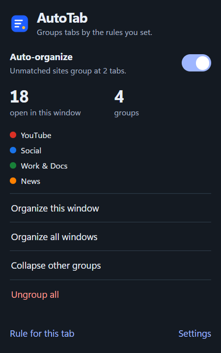
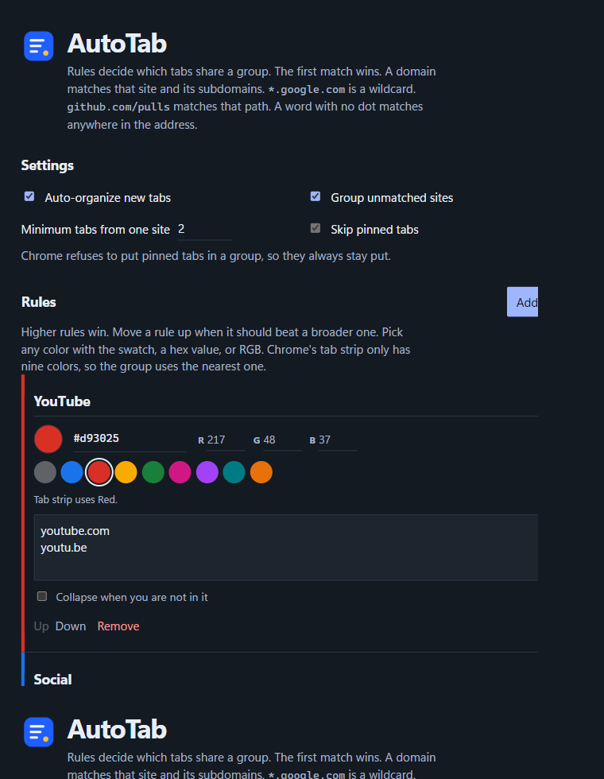
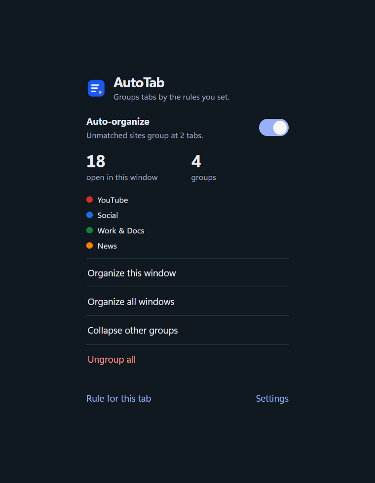

# AutoTab Organizer

Chrome extension that puts tabs into tab groups from rules you write. The first matching rule wins. A site with no rule can still get its own group once enough tabs from that site are open.

Chrome 116 or newer. No build step. Download [AutoTab-Organizer.zip](https://github.com/aansourav/AutoTab-Organizer/releases/latest/download/AutoTab-Organizer.zip).



## Install

Download [AutoTab-Organizer.zip](https://github.com/aansourav/AutoTab-Organizer/releases/latest/download/AutoTab-Organizer.zip) from the [latest release](https://github.com/aansourav/AutoTab-Organizer/releases/latest). Unzip it. On `chrome://extensions`, turn on Developer mode, choose Load unpacked, and select the unzipped folder. That folder is the one that contains `manifest.json`. Do not select `src` on its own.

Clicking a `.crx` from GitHub shows `CRX_REQUIRED_PROOF_MISSING`. Chrome only installs a packed file that came from the Chrome Web Store. Load unpacked is the install that works.

The same folder is the unpacked extension, so a reload of the extension card picks up source changes. Incognito windows stay out until you allow the extension on its card.

The signing key is not in this repo. A later pack of the same `.crx` id needs that private key, which stays on the machine that first packed it.

## Using it

The toolbar popup organizes the current window, organizes every window, collapses the groups you are not in, or ungroups the current window. Those buttons run even when auto-organize is off.

With auto-organize on, a new tab and a finished navigation are grouped as they happen. Pinned tabs stay put. Chrome will not put a pinned tab in a group, so the setting is locked on. Internal pages stay out too: `chrome://`, `chrome-extension://`, `edge://`, `about:`, devtools, view-source, and anything that is not http or https.



## Rules

One pattern per line. A pasted URL is trimmed down to a host and path.

- `youtube.com` matches that host and its subdomains.
- `*.google.com` matches `google.com` and every subdomain.
- `github.com/pulls` matches that path, and the path has to end on a segment boundary.
- A word with no dot, at least 3 characters, matches inside the host, path, query, or hash.

Higher rules win. Move a rule up when it should beat a broader one. The five built-in rules are YouTube, Social, Email, Work & Docs, and Dev. Sites that match none of them are grouped by registrable domain once the threshold is met. That threshold starts at 2, and those automatic groups lose to any custom rule.



## Colors

The picker, the hex field, and the R G B fields all store the same `#rrggbb`. `rgb(255, 128, 0)` and `#ff8000` are the same color.

Chrome's tab strip only has nine colors: grey, blue, red, yellow, green, pink, purple, cyan, orange. A custom hex is kept exactly, and the strip gets the nearest of those nine. `#ff8000` becomes Orange on the strip. The popup swatch stays `#ff8000`. Changing a color updates groups that are already open. The match is the group title.

## Develop

Node 20 or newer. There is nothing to install.

```
npm test
```

That regenerates the icons, checks `src/popup.js`, `src/options.js`, and `src/background.js`, then runs the tests. The tests use Node's built-in test runner and a fake `chrome` object.

`node scripts/generate-icons.mjs` writes `icons/icon16.png`, `icons/icon48.png`, and `icons/icon128.png`.

## License

[MIT](LICENSE). Copyright 2026 Abdullah.
